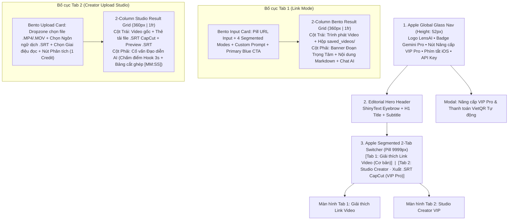

# LensAI Video — Product Design Specification & Apple Cinema Design System

> **Document Type:** Figma Product Design Specification (`figma-spec` + `DESIGN.md`)  
> **Product:** LensAI Video (`video-explainer` + `lensai-video-pro`)  
> **Live Production URL:** [https://lensai-video.onrender.com](https://lensai-video.onrender.com)  
> **Design System Foundation:** Apple Human Interface Guidelines (Dark Mode Cinema) + React Bits Interactive Micro-interactions

---

## 1. Product Overview & Core Architecture

**LensAI Video** là nền tảng AI đa phương thức (Multimodal Video AI) sử dụng **Google Gemini Pro** để xem trực tiếp từng khung hình, nghe âm thanh và giải quyết 2 bài toán cốt lõi thông qua kiến trúc **2-Tab Segmented Workspace** rõ ràng, không gây rối mắt:

| Chế độ (Workspace Tab) | Đối tượng sử dụng | Tính năng cốt lõi | Mô hình truy cập |
| :--- | :--- | :--- | :--- |
| **Tab 1: Giải thích Link Video** (`Cơ bản`) | Người xem TikTok, Facebook Reels, YouTube Shorts, IG Reels | Dán link video $\rightarrow$ AI tự động tải luồng video, dò **đoạn hướng dẫn trọng tâm nhất** (`[MM:SS - MM:SS]`), tóm tắt chuyên sâu, dịch lời thoại & hỏi đáp tiếp cùng AI | Miễn phí (Tự nhập Gemini API Key) hoặc dùng Mã VIP |
| **Tab 2: Studio Creator · Xuất .SRT CapCut** (`VIP Pro`) | Nhà sáng tạo nội dung (TikToker, Affiliate, Editor, Chủ shop) | Tải file video thô (`.MP4`, `.MOV`, `.WEBM`) từ máy lên $\rightarrow$ **Đạo diễn AI** chấm điểm 3 giây đầu (Hook), chỉ từng mốc `[MM:SS]` cần cắt bỏ/thêm hiệu ứng để lên xu hướng & **Xuất file `.SRT` khớp khung giờ** để đưa vào CapCut đọc tự động | Dành riêng cho gói **VIP Pro** (1 Credit / lượt) |

---

## 2. Design System Foundations (Figma Variables & Tokens)

### 2.1. Color Palette (Apple Pro Dark Cinema)

| Token Name (`Figma Variable`) | Hex Value | RGB (0–1) | Scopes | Mục đích sử dụng |
| :--- | :--- | :--- | :--- | :--- |
| `surface/canvas-black` | `#000000` | `{r: 0, g: 0, b: 0}` | `FRAME_FILL` | Nền chính toàn trang & khung trình phát Video Cinema |
| `surface/glass-nav` | `rgba(0,0,0,0.78)` | `{r: 0, g: 0, b: 0, a: 0.78}` | `FRAME_FILL` | Thanh điều hướng kính mờ cố định (`backdrop-filter: blur(20px)`) |
| `surface/bento-card` | `#161618` | `{r: 0.086, g: 0.086, b: 0.094}` | `FRAME_FILL` | Thẻ Bento chính chứa công cụ phân tích & kết quả |
| `surface/bento-elevated` | `#1C1C1E` | `{r: 0.11, g: 0.11, b: 0.118}` | `FRAME_FILL` | Ô nhập liệu, hộp thông tin file lưu, thẻ phụ đề `.SRT` |
| `text/primary` | `#F5F5F7` | `{r: 0.96, g: 0.96, b: 0.968}` | `TEXT_FILL` | Văn bản nội dung chính (Độ tương phản chuẩn AAA) |
| `text/pure-white` | `#FFFFFF` | `{r: 1, g: 1, b: 1}` | `TEXT_FILL` | Tiêu đề lớn (Hero Title, Section Header, Giá gói VIP) |
| `text/secondary` | `#86868B` | `{r: 0.525, g: 0.525, b: 0.545}` | `TEXT_FILL` | Nhãn phụ, mô tả hướng dẫn, chú thích |
| `accent/apple-blue` | `#0071E3` | `{r: 0, g: 0.443, b: 0.89}` | `FRAME_FILL`, `SHAPE_FILL` | Nút hành động chính (Primary CTA Pill) & Tab VIP Active |
| `accent/apple-link` | `#2997FF` | `{r: 0.16, g: 0.592, b: 1}` | `TEXT_FILL`, `STROKE_COLOR` | Liên kết, nút mốc thời gian `⏱ 00:15`, viền tiêu điểm |
| `accent/apple-green` | `#30D158` | `{r: 0.188, g: 0.82, b: 0.345}` | `FRAME_FILL`, `TEXT_FILL` | Nút tải file `.SRT` CapCut & trạng thái kích hoạt VIP thành công |
| `border/hairline` | `rgba(255,255,255,0.085)` | `{r: 1, g: 1, b: 1, a: 0.085}` | `STROKE_COLOR` | Viền mảnh 1px bao quanh các thẻ Bento & nút bấm |

---

### 2.2. Typography Scale (SF Pro / Inter)

- **Font Family:** `SF Pro Display` / `SF Pro Text` / `Inter` (`-apple-system, BlinkMacSystemFont`)
- **Monospace Family:** `SF Mono` (dùng cho tên file video, mã `VIP-XXXX-XXXX`, mốc thời gian `[MM:SS]` và nội dung file `.SRT`)
- **Weights:** Chỉ sử dụng `400 (Regular)`, `600 (SemiBold)`, `700 (Bold)`.

| Style Name | Size | Line Height | Letter Spacing | Weight | Ứng dụng |
| :--- | :--- | :--- | :--- | :--- | :--- |
| `Display / Hero Title` | `42px` | `46px` (`1.10`) | `-0.028em` | `700 Bold` | Tiêu đề chính: *"Hiểu sâu mọi video. Dựng clip lên xu hướng."* |
| `Heading / Card Title` | `18px` | `24px` (`1.33`) | `-0.020em` | `600 SemiBold` | Tiêu đề các khối Bento Card & Modal |
| `Body / Editorial` | `15px` | `25px` (`1.65`) | `-0.016em` | `400 Regular` | Nội dung giải thích AI & Cố vấn đạo diễn |
| `Control / Pill Label` | `13.5px` | `18px` (`1.33`) | `-0.010em` | `600 SemiBold` | Nhãn trên các nút bấm Pill, Segmented Tab |
| `Caption / Eyebrow` | `12px` | `16px` (`1.33`) | `+0.060em` | `600 SemiBold` | Nhãn `APPLE CINEMA INTELLIGENCE` & thẻ tag metadata |

---

### 2.3. Geometry & React Bits Interactive Effects

1. **Bento Card (`border-radius: 20px`, `padding: 24px`):**
   - Tích hợp hiệu ứng **React Bits `SpotlightCard`**: Theo dõi tọa độ chuột `(--mouse-x, --mouse-y)` để tạo vầng sáng radial `560px` màu `rgba(41, 151, 255, 0.09)` di chuyển mượt dưới bề mặt thẻ.
2. **Full Pill Controls (`border-radius: 9999px`):**
   - Áp dụng cho thanh tìm kiếm URL, thanh chuyển đổi 2-Tab (`pro-workspace-tabs`), nút Primary CTA (`Phân tích Video`), và các nút Timestamp (`⏱ 00:15`).
3. **React Bits `ShinyText` & `BlurText`:**
   - Dòng nhãn Hero Eyebrow chạy hiệu ứng ánh kim `rb-shine` chu kỳ `6s`.
   - Khi chuyển đổi giữa Tab 1 và Tab 2, khung nội dung xuất hiện với hiệu ứng `rb-blur-in` (`filter: blur(12px) -> blur(0)` trong `0.45s`).

---

## 3. Screen-by-Screen Layout Specification

---

## 4. User Flows & CapCut `.SRT` Integration Spec

### 4.1. Luồng Studio Creator & Xuất file `.SRT` vào CapCut
1. Người dùng chuyển sang tab **`Studio Creator · Xuất .SRT CapCut (VIP Pro)`**.
2. Chọn file video cá nhân từ máy (`.MP4`, `.MOV`, `.WEBM` tối đa 60MB).
3. Chọn **Ngôn ngữ phụ đề/lời bình** (`Tiếng Việt`, `Tiếng Anh`, `Tiếng Trung`, `Tiếng Nhật`, `Tiếng Hàn`) và **Giai điệu đọc** (`TikTok Viral`, `Bán hàng Affiliate`, `Chuyên gia`, `Hài hước GenZ`, `Kể chuyện điện ảnh`).
4. Nhấn **Phân tích Cắt ghép & Xuất File .SRT CapCut (1 Credit)**:
   - Backend tải video lên Gemini File API, phân tích đồng thời hình ảnh + âm thanh.
   - Trả về **Bản Cố vấn Đạo diễn AI** (chấm điểm 3 giây đầu, liệt kê từng mốc `[MM:SS]` cần cắt bỏ hoặc chèn hiệu ứng).
   - Tự động trích xuất khối `.SRT` chuẩn khung thời gian (`00:00:00,000 --> 00:00:03,200`) và **tự động tải file `.srt` về máy**.
5. Người dùng mở **CapCut** $\rightarrow$ **Văn bản (Text)** $\rightarrow$ **Phụ đề nội bộ (Local Captions)** $\rightarrow$ Nhập file `.srt` $\rightarrow$ Bấm **Đọc văn bản (Text-to-Speech)** và bật *"Đồng bộ giọng đọc với phụ đề"*.
