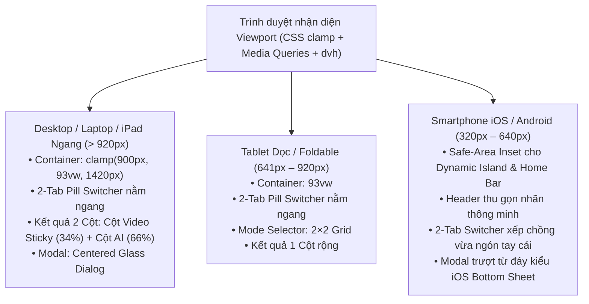

# LensAI Video — Product Design Specification & Universal Multi-Device Auto-Scaling System

> **Document Type:** Figma Product Design Specification (`figma-spec` + `DESIGN.md`)  
> **Product:** LensAI Video (`video-explainer` + `lensai-video-pro`)  
> **Live Production URL:** [https://lensai-video.onrender.com](https://lensai-video.onrender.com)  
> **Design System Foundation:** Apple Human Interface Guidelines (Dark Mode Cinema) + React Bits Interactive Micro-interactions + Fluid CSS `clamp()` Auto-Scaling

---

## 1. Product Overview & Core Architecture

**LensAI Video** là nền tảng AI đa phương thức (Multimodal Video AI) sử dụng **Google Gemini Pro** để xem trực tiếp từng khung hình, nghe âm thanh và giải quyết 2 bài toán cốt lõi thông qua kiến trúc **2-Tab Segmented Workspace** rõ ràng, không gây rối mắt:

| Chế độ (Workspace Tab) | Đối tượng sử dụng | Tính năng cốt lõi | Mô hình truy cập |
| :--- | :--- | :--- | :--- |
| **Tab 1: Giải thích Link Video** (`Cơ bản`) | Người xem TikTok, Facebook Reels, YouTube Shorts, IG Reels | Dán link video $\rightarrow$ AI tự động tải luồng video, dò **đoạn hướng dẫn trọng tâm nhất** (`[MM:SS - MM:SS]`), tóm tắt chuyên sâu, dịch lời thoại & hỏi đáp tiếp cùng AI | Miễn phí (Tự nhập Gemini API Key) hoặc dùng Mã VIP |
| **Tab 2: Studio Creator · Xuất .SRT CapCut** (`VIP Pro`) | Nhà sáng tạo nội dung (TikToker, Affiliate, Editor, Chủ shop) | Tải file video thô (`.MP4`, `.MOV`, `.WEBM`) từ máy lên $\rightarrow$ **Đạo diễn AI** chấm điểm 3 giây đầu (Hook), chỉ từng mốc `[MM:SS]` cần cắt bỏ/thêm hiệu ứng để lên xu hướng & **Xuất file `.SRT` khớp khung giờ** để đưa vào CapCut đọc tự động | Dành riêng cho gói **VIP Pro** (1 Credit / lượt) |

---

## 2. Universal Multi-Device Auto-Scaling Matrix (Mọi Thiết Bị & Kích Thước Màn Hình)

Hệ thống giao diện được thiết kế theo triết lý **Fluid Responsive + Safe-Area First**, tự động co giãn mượt mà từ màn hình điện thoại nhỏ nhất (`320px`) tới màn hình 4K Studio Display (`2560px+`):

| Phân khúc Thiết bị | Độ rộng Viewport | Container Max-Width | Bố cục Kết quả (`result-layout`) | Bộ chọn Chế độ (`mode-selector`) | Kiểu hiển thị Modal |
| :--- | :--- | :--- | :--- | :--- | :--- |
| **1. Ultra-Compact Mobile & Split-View** *(iPhone SE, Galaxy Fold ngoài)* | `320px – 370px` | `100%` (Padding `12px`) | `1 cột` (Xếp chồng dọc) | `1 cột` (4 hàng) | **iOS Bottom Sheet** (`border-radius: 22px 22px 0 0`) |
| **2. Smartphone Tiêu chuẩn & Pro Max** *(iPhone 15/16 Pro Max, Android)* | `371px – 640px` | `100%` (Padding `clamp(12px, 3.2vw, 20px)`) | `1 cột` (Video cao tối đa `54dvh` để không che kết quả) | `2 cột × 2 hàng` | **iOS Bottom Sheet** trượt từ đáy + `safe-area-inset-bottom` |
| **3. Tablet Portrait & Foldable Mở** *(iPad Mini, iPad Air dọc, Z Fold mở)* | `641px – 920px` | `93vw` | `1 cột` rộng rãi, thanh tìm kiếm & nút nằm ngang | `2 cột × 2 hàng` | **Centered Glass Dialog** (`max-width: 520px–820px`) |
| **4. Tablet Landscape & Laptop 13"–16"** *(iPad Pro ngang, MacBook Air/Pro)* | `921px – 1599px` | `clamp(900px, 93vw, 1340px)` | **2 cột Tỉ lệ vàng** (`minmax(300px, 34%)` Trái Sticky + `1fr` Phải) | `4 cột ngang` (`repeat(4, 1fr)`) | **Centered Glass Dialog** (`max-height: 88dvh`) |
| **5. Desktop 24"–32" 2K/4K UltraWide** *(iMac, Apple Studio Display)* | `1600px – 2560px+` | `1420px` (Căn giữa cân đối) | **2 cột** (`400px` Trái Sticky Video + `1000px` Phải) | `4 cột ngang` | **Centered Glass Dialog** (`860px`) |

---

### 2.1. Công thức Fluid CSS `clamp()` & Quy tắc iOS/Android Native
1. **Fluid Typography (Tự động phóng chữ theo độ rộng màn hình):**
   - `Hero Title`: `clamp(1.45rem, 1.1rem + 2.4vw, 2.75rem)` (Từ `23.2px` trên iPhone nhỏ $\rightarrow$ `44px` trên Desktop).
   - `Hero Subtitle`: `clamp(0.84rem, 0.8rem + 0.3vw, 1.02rem)`.
   - `Section Heading`: `clamp(0.96rem, 0.9rem + 0.25vw, 1.08rem)`.
   - `Editorial Body`: `clamp(0.9rem, 0.86rem + 0.18vw, 0.96rem)`.
2. **Chống lỗi iOS Safari tự động Zoom khi chạm vào ô nhập liệu:**
   - Mọi thẻ `<input>` và `<select>` đều áp dụng `font-size: clamp(16px, ...)` (tối thiểu `16px`), giúp iPhone/iPad giữ nguyên tỷ lệ khung hình khi bàn phím ảo bật lên.
3. **Dynamic Viewport Height (`100dvh`) & Tai thỏ (`env(safe-area-inset-*)`):**
   - Sử dụng `100dvh` thay cho `100vh` thuần túy để tự động thích ứng khi thanh địa chỉ Safari/Chrome thu gọn hoặc mở rộng.
   - Đệm tự động `env(safe-area-inset-top)` trên thanh Header và `env(safe-area-inset-bottom)` dưới đáy trang / Bottom Sheet Modal cho iPhone Dynamic Island.

---

## 3. Design System Foundations (Figma Variables & Tokens)

| Token Name (`Figma Variable`) | Hex Value | RGB (0–1) | Scopes | Mục đích sử dụng |
| :--- | :--- | :--- | :--- | :--- |
| `surface/canvas-black` | `#000000` | `{r: 0, g: 0, b: 0}` | `FRAME_FILL` | Nền chính toàn trang & khung trình phát Video Cinema |
| `surface/glass-nav` | `rgba(0,0,0,0.78)` | `{r: 0, g: 0, b: 0, a: 0.78}` | `FRAME_FILL` | Thanh điều hướng kính mờ cố định (`backdrop-filter: blur(20px)`) |
| `surface/bento-card` | `#161618` | `{r: 0.086, g: 0.086, b: 0.094}` | `FRAME_FILL` | Thẻ Bento chính chứa công cụ phân tích & kết quả |
| `surface/bento-elevated` | `#1C1C1E` | `{r: 0.11, g: 0.11, b: 0.118}` | `FRAME_FILL` | Ô nhập liệu, hộp thông tin file lưu, thẻ phụ đề `.SRT` |
| `text/primary` | `#F5F5F7` | `{r: 0.96, g: 0.96, b: 0.968}` | `TEXT_FILL` | Văn bản nội dung chính (Độ tương phản chuẩn AAA) |
| `text/pure-white` | `#FFFFFF` | `{r: 1, g: 1, b: 1}` | `TEXT_FILL` | Tiêu đề lớn (Hero Title, Section Header, Giá gói VIP) |
| `text/secondary` | `#86868B` | `{r: 0.525, g: 0.525, b: 0.545}` | `TEXT_FILL` | Nhãn phụ, mô tả hướng dẫn, chú thích |
| `accent/apple-blue` | `#0071E3` | `{r: 0, g: 0.443, b: 0.89}` | `FRAME_FILL`, `SHAPE_FILL` | Nút hành động chính (Primary CTA Pill) & Tab VIP Active |
| `accent/apple-link` | `#2997FF` | `{r: 0.16, g: 0.592, b: 1}` | `TEXT_FILL`, `STROKE_COLOR` | Liên kết, nút mốc thời gian `⏱ 00:15`, viền tiêu điểm |
| `accent/apple-green` | `#30D158` | `{r: 0.188, g: 0.82, b: 0.345}` | `FRAME_FILL`, `TEXT_FILL` | Nút tải file `.SRT` CapCut & trạng thái kích hoạt VIP thành công |
| `border/hairline` | `rgba(255,255,255,0.085)` | `{r: 1, g: 1, b: 1, a: 0.085}` | `STROKE_COLOR` | Viền mảnh 1px bao quanh các thẻ Bento & nút bấm |

---

## 4. Multi-Device Architecture Diagram

